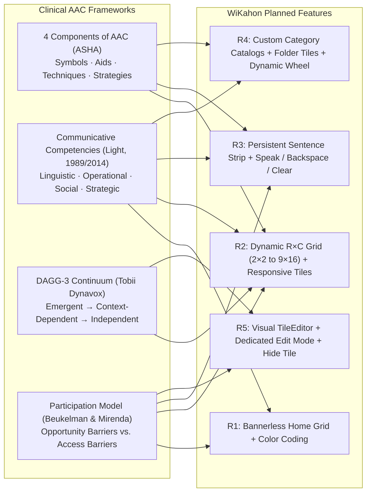

# WiKahon AAC Board Redesign — Research-Backed Implementation Plan

## Goal Description

WiKahon (`seals/`) is a Next.js 16 (App Router) + React 19 + Zustand Augmentative and Alternative Communication (AAC) web application for Filipino/Taglish communicators. Currently, the board is constrained to a hard-coded `5 × 4` (20-slot) grid, displays four static category header banners on the Home board, replaces a single-word display box on every tile tap (preventing multi-word sentence construction), hard-codes four categories (`needs`, `actions`, `people`, `feelings`) with `dynamicParams = false`, and uses a minimal modal (`WordPicker.tsx`) with text-only word buttons and a `<select>` dropdown for icons.

This plan addresses **all five requested changes** while grounding every architectural and UX decision in clinical AAC literature and established English and Filipino AAC systems:

1. **R1 — Remove categories/labels in the main (Home) board** to maximize tile target area and rely on color-coding (modified Fitzgerald Key / category palette) rather than header banners.
2. **R2 — Configurable tile dimensions & board grid sizes** (e.g., `6×6`, `7×9`, up to `9×16` = 144 locations, plus custom `rows × cols`) with container-responsive tile scaling and coordinate-stable (`row:col`) slot storage to preserve motor planning.
3. **R3 — Persistent sentence formation strip (`SentenceStrip`)** that retains selected words across board navigation until cleared, adds a dedicated **Speak** button (`🔊`), **Backspace** (`⌫`), per-chip tap-to-remove, and **Clear** (`✕`), and removes the old single-word display box.
4. **R4 — Category folders (Catalogs) for words** with full support to create, rename, recolor, and delete custom catalogs, add existing or new words into catalogs, place **Folder tiles** on the board, and dynamically compute sectors in `CategoryWheel`.
5. **R5 — Improved tile customization layouts** via a two-column visual `TileEditor` (live tile preview, visual GIF icon grid, search & catalog filters, Existing / New / Folder tabs, custom spoken text) and a dedicated **Edit Mode** with a per-tile action menu (*Edit · Replace · Move/Swap · Hide · Remove*).

> [!IMPORTANT]
> **Compliance with [AGENTS.md](file:///c:/Users/mors/OneDrive/Documents/CBINOV3/CBINOV3-SEALs/seals/AGENTS.md):**
> - **MVVM Architecture:** All presentation state, gesture math (swipe pagination, long-press timers, pointer movement tolerances), and speech orchestration are encapsulated in headless React hooks under `seals/viewmodels/use*ViewModel.ts`. Views under `seals/app/components/` remain declarative and thin.
> - **Strict File Boundaries:** `README.md`, `seals/README.md`, `seals/models/Words.json`, and `seals/lib/ttsClient.ts` are **never modified**.

---

## Research Synthesis & Architectural Traceability

### 1. Review of Reference AAC Applications & Boards

#### A. English AAC Systems: Proloquo2Go, TouchChat (WordPower), and AACBoard (AAC Board AI / Cboard)

| System | Core Mechanisms Reviewed | Direct Design Impact on WiKahon |
|---|---|---|
| **Proloquo2Go** *(AssistiveWare)* | • **Crescendo™ Vocabulary & Motor Planning:** Keeps core words in predictable spatial coordinates across grid sizes (`9` to `144` buttons) so users build muscle memory.<br>• **Progressive Language:** Allows hiding individual tiles in-place (`hidden` flag) without shifting adjacent tiles.<br>• **Folders:** Combines core tiles with topic folders that navigate to sub-boards.<br>• **Message Bar:** Accumulates tapped symbol+word chips at the top; tapping the bar or Speak button voices the whole sentence; *Auto-Clear Message* defaults to **Off**.<br>• **Edit Mode & Restrictions:** Separates editing from communication mode with an optional PIN lock. | • **R2 (`row:col` Cell Map):** Store board slots by `"row:col"` coordinates instead of a flat array so changing grid dimensions never scrambles existing tile positions.<br>• **R3 (`SentenceStrip`):** Retain words across folder navigation until manually cleared.<br>• **R4 (Folder Tiles):** Support `kind: "folder"` tiles on the grid alongside the radial `CategoryWheel`.<br>• **R5 (Edit Mode + Hide):** Add header `✎ Edit` mode and in-place tile hiding. |
| **TouchChat HD with WordPower** *(PRC-Saltillo)* | • **Speech Display Bar (SDB):** Persistent top sentence window supporting chip tap-to-delete, Backspace, Clear, and Speak.<br>• **Speech Granularity:** Separate settings for *Speak Words* (voice on tap) and *Auto Clear* (*Off*, *Immediate*, *After Next Activation*).<br>• **Field Sizes:** Configurable grids (`15`, `20`, `24`, `60`, `80`, `140` buttons) matched to motor and visual acuity.<br>• **Modified Fitzgerald Color Coding:** Distinguishes word classes by tile background/border color without column header banners. | • **R1 (Banner Removal):** Remove `CategoryBanner` row from `HomeBoard.tsx`; rely on tile color coding.<br>• **R2 (Grid Presets & Container Scaling):** Scale tile icons and typography via CSS container queries (`@container`, `cqmin`) so `6×6` and `7×9` fit without scrolling.<br>• **R3 (Speech Settings):** Parameterize `speakOnTap` and `autoClear` in the store and `useSentenceViewModel`. |
| **AACBoard** *(AAC Board AI `aacboard.app` / Cboard)* | • **Local-First Web PWA:** Persists custom boards and symbols in browser storage; works offline using `window.speechSynthesis` fallback.<br>• **Open Board Format (OBF / `.obf`):** Models every view (Home and category folders) uniformly as a `Board` with `grid: { rows, columns, order }` and `buttons` (`label`, `vocal_text`, `image_id`, `load_board` for folders).<br>• **Accessible Keyboard & Touch:** Full keyboard navigation alongside direct touch. | • **R4 (Unified Board Model):** Represent Home (`"home"`), the 4 built-in categories, and all user-created catalogs as `Board` records in Zustand.<br>• **R5 (`TileEditor`):** Allow optional `spokenText` (`vocal_text`) distinct from visual `label` (e.g., label `"Kain"` → speaks `"Gusto kong kumain"`). |

#### B. Filipino AAC Systems: Filipino Manual Communication Board (Chua, UP Manila) & AAClatan

| Filipino Reference | Key Findings | Direct Design Impact on WiKahon |
|---|---|---|
| **Filipino Manual Communication Board with Core Vocabulary** *(Chua, E. C. K., Dept. of Speech Pathology, UP Manila)* | • **Corpus-Derived Core Vocabulary:** Extracted 137 high-frequency Tagalog core words ($\ge 0.5$ per 1,000 words) across McFarland (1989), Chin (2012), and Marzan (2013) corpora.<br>• **`9×16` (144-location) Bannerless Grid:** Uses a Modified Fitzgerald Key color scheme with **no category header banners**, arranged left-to-right in Tagalog's **Verb-Subject-Object (Predicate-Initial)** order: Social/Questions (Red/Black) → Verbs (Green) → Pronouns (Yellow) → Particles/Markers/Connectives (Pink, **text-only tiles** for *ang, sa, ng, mga, ni, si, kay, na, pa, po*) → Modifiers (Blue) → Locatives (Purple).<br>• **Evaluated via Lahey's (1988) Content / Form / Use:** Covers early semantic categories and all 13 Tagalog clause structures (Marzan, 2013: Predicate + Agent + Object `bukas mo ito`, Predicate + Subject + Oblique `kain tayo doon`, Non-verbal Predicate + Subject `mayroon ako`).<br>• **Clinical Limitations Identified by Chua:**<br>  1. Core words alone are **inadequate for symbolic/pretend play and labeling** (Westby, 2000; Westby & Wilson, 2017) — **fringe vocabulary per theme is essential**.<br>  2. Lacks **social etiquette routines** (*po, opo, salamat*).*<br>  3. Tagalog morphology relies heavily on affixes. | • **R1:** Confirms removing category header banners on the board and using color-coding (by Catalog or by Modified Fitzgerald Word Class).<br>• **R2:** Adds `9×16` (144-slot) as the top preset alongside `6×6` and `7×9`, and supports **text-only tiles** (`iconName: null`) with large centered typography for Filipino particles/markers (*ang, ng, sa, po*).<br>• **R3:** Multi-word Tagalog clause building (`kain + tayo + doon`) requires the persistent `SentenceStrip`.<br>• **R4:** Directly validates user-created **Category Folders (Catalogs)** so clinicians/families can add thematic fringe vocabulary for play, school, and home routines. |
| **AAClatan** *(UP Spin-Off, `aaclatan.com`)* | • Built by UP SLP, Engineering, and Fine Arts graduates (*"Wika at Ugnayan Para sa Lahat"*).<br>• Organizes vocabulary into culturally relevant Filipino contexts (*Bahay, Eskwela, Lakad, Handaan*) and uses OBF-compatible board structures. | • **R4 & R5:** Supports creating custom contextual catalogs (e.g., *Bahay*, *Eskwela*, *Pagkain*) with localized labels, custom spoken phrases, and `fil-PH` offline Web Speech API fallback. |

---

### 2. Clinical & Theoretical AAC Frameworks



1. **4 Components of AAC (ASHA):**
   - **Symbols:** Aided graphic symbols (animated GIFs in `public/gifs/`), **text-only orthographic tiles** (for Tagalog enclitics/markers), and distinct **Folder tiles** (`load_board`).
   - **Aids:** High-tech browser SGD with local persistence (`localStorage` v2 schema) and offline Web Speech API (`fil-PH` / `tl-PH`) fallback when Puter.js cloud TTS is unreachable.
   - **Techniques:** Direct selection via touch, mouse, or keyboard (`Arrow` keys, `Enter`/`Space`, `F2`, `Escape`) with configurable hold duration (`holdMs`) and pointer drift tolerance (`moveTolerancePx`).
   - **Strategies:** Multi-word sentence accumulation, optional word-on-tap audio scaffolding, Fitzgerald/category color-coding, and progressive vocabulary disclosure (`hidden` tiles).
2. **AAC Communication Competencies (Light, 1989; Light & McNaughton, 2014):**
   - **Linguistic Competence:** Transitioning from single-word labeling to multi-word Tagalog/English clause generation in `SentenceStrip`, plus expanding lexical breadth through user-created fringe `Catalogs`.
   - **Operational Competence:** Removing the Home category header banners (`R1`) to increase vertical tile real estate, scaling grid dimensions (`R2`) to match motor/visual capability, and keeping folder/page navigation consistent.
   - **Social Competence:** Dedicated **Speak** button (`🔊`) for conversational turn-taking, optional `spokenText` for complete polite social routines (e.g., `"Pakisuyo po"`), and optional immediate word voice output.
   - **Strategic Competence:** Fast error repair during conversation breakdowns via per-chip tap-to-remove, **Backspace** (`⌫`), **Clear** (`✕`), and re-speaking the sentence strip.
3. **Dynamic AAC Goals Grid – 3rd Edition (DAGG-3, Tobii Dynavox / Clarke & Schneider / Dowden):**
   - Maps learners across five ability levels (*Emergent → Emergent Transitional → Context-Dependent → Transitional Independent → Independent*). WiKahon's **Grid Dimension Presets (`R2`)** align directly with this continuum as clinician-selectable starting points:
     - *Emergent (`2×2`, `3×3`)*: High-visibility large tiles, cause-and-effect / basic choice-making.
     - *Emergent Transitional (`3×4`, `4×4`)*: Early symbolic selection and 2-word combinations.
     - *Context-Dependent (`5×4` default, `5×6`, `6×6`)*: Core words + routine-specific catalogs (*Needs, Actions, People, Feelings* + custom folders).
     - *Transitional Independent (`6×8`, `7×9`)*: Broader core and fringe access for novel multi-word sentences across environments.
     - *Independent (`8×10`, `9×16` = 144 locations)*: Full high-density layout matching Chua's 144-location Filipino Core Board.
4. **AAC Participation Model (Beukelman & Mirenda, 1988; Beukelman & Light, 2020):**
   - **Dismantling Opportunity Barriers (External):**
     - *Practice Barriers* (partners interrupting or guessing before the user finishes a thought): The visible `SentenceStrip` shows words accumulating in real time and speaks the full message on command.
     - *Facilitator Skill & Knowledge Barriers* (caregivers/teachers intimidated by complex board programming): `TileEditor` provides a live preview, visual GIF picker, search bar, and one-click catalog assignment; `CatalogManager` makes creating topic folders effortless.
   - **Dismantling Access Barriers (Internal / System):**
     - *Motor & Visual Access:* Configurable `rows × cols` (`R2`), container-query responsive icons/labels, adjustable grid gap, and separating **Edit Mode** from communication mode so tremors or slow releases (>500 ms) do not accidentally trigger tile deletion.

---

## User Review Required

> [!IMPORTANT]
> **1. Store Schema Upgrade (`v1 → v2`) with Automatic Migration:**
> To support arbitrary grid dimensions (`6×6`, `7×9`, etc.) without scrambling tile positions (preserving *motor planning*) and to support user-created Catalogs and Folder tiles, `useBoardStore` upgrades from `version: 1` to `version: 2`:
> - A central `tiles: Record<string, Tile>` dictionary stores all word and folder definitions.
> - A unified `boards: Record<BoardId, Board>` map stores `"home"`, the 4 built-in categories, and any custom catalogs, where each page maps `"row:col"` coordinates (`CellKey`) to `{ tileId, hidden? }`.
> - A deterministic `migrateV1toV2` function converts any existing `wikahon-board-v1` data in `localStorage` so **all existing custom words and home/category placements remain in their exact visual row and column**.

> [!IMPORTANT]
> **2. Explicit Edit Mode vs. Long-Press in Communication Mode:**
> In Proloquo2Go, TouchChat, and the Participation Model, accidental long-presses during communication are a major operational barrier for users with motor impairments. We propose adding a `✎ Edit` toggle button in `BoardShell` (with an optional PIN lock in Settings), while keeping long-press-to-edit (`500ms`) as a configurable toggle in Settings.

---

## Open Questions & Confirmed Decisions

> [!IMPORTANT]
> Item 2 has been updated to be **fully user-settable** per your feedback. Please confirm if you are ready to proceed with the remaining defaults:

1. **Category Banner Removal Scope (R1):** Remove `CategoryBanner` **only on the Home board**, and show a compact catalog header bar (`← Home`, catalog title, `+ Add word`) on Category pages.
2. **Grid Dimension Scope, Orientation & Tile Dimensions (R2) — ✅ Confirmed User-Settable:**
   - **User-Settable Scope:** In `BoardSettings`, the user can toggle between **Apply to All Boards (Global)** or **Customize Per Board / Catalog** (selecting Home or any specific catalog to have its own independent `rows × cols`).
   - **User-Settable Dimensions & Orientation:** Users can pick quick presets (`2×2` up to `6×6`, `7×9`, `9×16`), set any custom **Rows** and **Columns** (`1–16`), or click **`⇄ Swap Orientation (Rows ↔ Columns)`** (e.g., switching `7×9` ↔ `9×7`).
   - **User-Settable Tile Dimensions:** Users can also adjust tile size/density controls (Icon size ratio, Label font scale, Label position Top/Bottom, and Grid gap) with a live visual preview.
3. **Tap Speech Behavior (R3):** Speak each word on tap by default, with a user-settable toggle in Settings (*"Speak each word when tapped"*), plus the dedicated **`🔊 Speak`** button for the full sentence.
4. **Auto-Clear Sentence Behavior (R3):** Default **Auto-Clear** to **Off** so selected words stay in `SentenceStrip` across folders until manually cleared (`✕` or `⌫`), with a user-settable option in Settings (*Keep until cleared* / *Clear after speaking* / *Clear on next tap*).
5. **Built-in Catalog Protection (R4):** Allow renaming/recoloring the 4 initial catalogs (*Needs, Actions, People, Feelings*) while protecting them from deletion; user-created catalogs can be freely created, edited, and deleted.

---

## Proposed Changes

### Component Architecture Overview (MVVM)

```text
seals/
├── app/
│   ├── board/
│   │   ├── layout.tsx                    (unchanged)
│   │   ├── page.tsx                      (unchanged)
│   │   └── [categoryId]/page.tsx         [MODIFY] dynamicParams = true for custom catalogs
│   ├── components/
│   │   ├── BoardShell.tsx                [MODIFY] Header SentenceStrip + Edit & Settings triggers
│   │   ├── SentenceStrip.tsx             [NEW]    Persistent sentence box, chips, Speak/Backspace/Clear
│   │   ├── BoardGrid.tsx                 [NEW]    Unified dynamic R×C grid view for Home & Catalogs
│   │   ├── HomeBoard.tsx                 [MODIFY] Remove CategoryBanner row; render BoardGrid("home")
│   │   ├── CategoryBoard.tsx             [MODIFY] Render catalog header + BoardGrid(categoryId)
│   │   ├── TileButton.tsx                [MODIFY] Container-responsive sizing, folder variant, text-only support
│   │   ├── CategoryWheel.tsx             [MODIFY] Dynamic N-sector SVG calculation + "+ Catalog" shortcut
│   │   ├── TileEditor.tsx                [NEW]    Replaces WordPicker: 2-column layout, live preview, GIF grid
│   │   ├── TileActionMenu.tsx            [NEW]    Popover for Edit / Replace / Move / Hide / Remove
│   │   ├── CatalogManager.tsx            [NEW]    Create/edit/delete catalogs & batch-add words
│   │   ├── BoardSettings.tsx             [NEW]    Grid size presets (6×6, 7×9, etc.), appearance & speech settings
│   │   ├── EditableTileSlot.tsx          [DELETE] Superseded by BoardGrid + useTileInteractionViewModel
│   │   └── WordPicker.tsx                [DELETE] Superseded by TileEditor
│   ├── theme.tsx                         [MODIFY] Add extended palette (ColorKey) & sentence strip tokens
│   └── globals.css                       [MODIFY] Container query helpers, folder tab & chip animations
├── viewmodels/                           [NEW]    Headless MVVM hooks (zero JSX)
│   ├── useSentenceViewModel.ts           [NEW]
│   ├── useBoardGridViewModel.ts          [NEW]
│   ├── useTileInteractionViewModel.ts    [NEW]
│   ├── useEditModeViewModel.ts           [NEW]
│   ├── useBoardSettingsViewModel.ts      [NEW]
│   ├── useCatalogManagerViewModel.ts     [NEW]
│   ├── useTileEditorViewModel.ts         [NEW]
│   └── useCategoryWheelViewModel.ts      [NEW]
├── services/
│   └── tts/
│       └── ttsService.ts                 [NEW]    ITTSService wrapping playTTS + offline fil-PH Web Speech fallback
├── lib/
│   └── board.ts                          [MODIFY] Domain types, grid presets, palette, cell coordinate helpers
└── store/
    ├── useBoardStore.ts                  [MODIFY] v2 store state, actions, and v1→v2 migration
    └── BoardProvider.tsx                 [MODIFY] Add shallow selector helper
```

---

### 1. Model Layer (`lib/board.ts`, `store/`, `services/tts/`)

#### [MODIFY] [board.ts](file:///c:/Users/mors/OneDrive/Documents/CBINOV3/CBINOV3-SEALs/seals/lib/board.ts)
- Retain backwards-compatible exports (`CATEGORY_IDS`, `CATEGORIES`, `ICONS`, `iconPath`, `isCategoryId`) where needed while introducing the OBF-inspired domain entities:
  - `ColorKey`: `"rose" | "emerald" | "amber" | "blue" | "violet" | "teal" | "orange" | "pink" | "slate"`
  - `WordClass` (Modified Fitzgerald Key per Chua's Filipino board & WordPower): `"social" | "question" | "verb" | "pronoun" | "particle" | "modifier" | "place" | "noun" | "other"`
  - `Tile`:
    ```ts
    export interface Tile {
      id: string;
      kind: "word" | "folder";
      label: string;
      spokenText?: string;       // Optional vocal_text override; defaults to label
      iconName: string | null;   // null = text-only tile (e.g., Tagalog particles "ang", "po")
      categoryId: string;        // Owning/origin catalog ID
      targetBoardId?: string;    // Populated when kind === "folder"
      colorKey?: ColorKey;       // Optional per-tile color override
      wordClass?: WordClass;     // Optional Fitzgerald key grammatical class
      isCustom?: boolean;
    }
    ```
  - `CellKey = `${number}:${number}`` (`"row:col"`), `CellPlacement = { tileId: string; hidden?: boolean }`, `BoardPage = { cells: Record<CellKey, CellPlacement> }`.
  - `CatalogBoard`:
    ```ts
    export interface CatalogBoard {
      id: string;                // "home" | "needs" | "actions" | "people" | "feelings" | `cat-${uuid}`
      name: string;              // Full display name (e.g., "Needs / Emergency", "Pagkain")
      shortName: string;         // Wheel label (e.g., "Needs", "Pagkain")
      colorKey: ColorKey;
      iconName: string | null;
      isBuiltIn: boolean;
      gridOverride?: GridConfig; // Optional per-catalog R×C override
      pages: BoardPage[];
    }
    ```
  - `GridConfig = { rows: number; cols: number }`, `DEFAULT_GRID = { rows: 5, cols: 4 }`, `GRID_LIMITS = { minRows: 1, maxRows: 16, minCols: 1, maxCols: 16 }`, and DAGG-3-aligned `GRID_PRESETS`:
    - `2×2` & `3×3` (*Emergent*), `3×4` & `4×4` (*Emergent Transitional*), `5×4` (*Current Default*), `5×6` & `6×6` (*Context-Dependent*), `6×8` & `7×9` (*Transitional Independent*), `8×10` & `9×16` (*Independent / 144-location Filipino Core Board*).
  - Expand `ICONS` to include all 23 GIFs present in `seals/public/gifs/` (adding `tigil.gif`, `ayoko.gif`, and `gusto-ko-pa.gif` which are currently in `public/gifs/` and `Words.json` Archive but omitted from `ICONS`).

---

#### [MODIFY] [useBoardStore.ts](file:///c:/Users/mors/OneDrive/Documents/CBINOV3/CBINOV3-SEALs/seals/store/useBoardStore.ts)
- Upgrade persisted store to `version: 2` with `migrate` from `v1`:
  ```ts
  export interface SentenceToken {
    instanceId: string;
    tileId: string;
    label: string;
    spokenText: string;
    iconName: string | null;
    colorKey: ColorKey;
  }

  export interface BoardState {
    tiles: Record<string, Tile>;
    boards: Record<string, CatalogBoard>;
    catalogOrder: string[];               // Ordered catalog IDs (excluding "home")
    gridConfig: GridConfig;               // Global rows × cols (default 5×4)
    tileAppearance: {
      labelPosition: "bottom" | "top";
      fontScale: "sm" | "md" | "lg";
      iconScale: "sm" | "md" | "lg";
      showIcons: boolean;
      gridGap: "compact" | "normal" | "relaxed";
      colorMode: "catalog" | "wordClass";
    };
    speechConfig: {
      volume: number;
      speakOnTap: boolean;
      autoClear: "off" | "afterSpeak" | "nextTap";
    };
    accessConfig: {
      editPin: string | null;
      longPressToEdit: boolean;
      holdDurationMs: number;
      moveTolerancePx: number;
    };
    sentence: SentenceToken[];            // Retained across board routes until cleared

    // Grid & Appearance Actions
    setGridConfig: (config: GridConfig, boardId?: string | null) => void;
    reflowOutOfBoundsTiles: (boardId: string) => void;
    setTileAppearance: (patch: Partial<BoardState["tileAppearance"]>) => void;
    setSpeechConfig: (patch: Partial<BoardState["speechConfig"]>) => void;
    setAccessConfig: (patch: Partial<BoardState["accessConfig"]>) => void;

    // Sentence Actions (R3)
    appendSentenceTile: (tile: Tile) => void;
    removeSentenceTokenAt: (index: number) => void;
    popSentenceToken: () => void;
    clearSentence: () => void;

    // Tile & Slot Actions (R4, R5)
    upsertTile: (tile: Tile) => void;
    assignSlot: (boardId: string, pageIndex: number, cell: CellKey, tileId: string | null) => void;
    swapSlots: (boardId: string, pageIndex: number, fromCell: CellKey, toCell: CellKey) => void;
    setSlotHidden: (boardId: string, pageIndex: number, cell: CellKey, hidden: boolean) => void;

    // Catalog / Folder Actions (R4)
    createCatalog: (input: { name: string; shortName?: string; colorKey: ColorKey; iconName: string | null; placeFolderOnHome?: boolean }) => string;
    updateCatalog: (catalogId: string, patch: Partial<Pick<CatalogBoard, "name" | "shortName" | "colorKey" | "iconName" | "gridOverride">>) => void;
    deleteCatalog: (catalogId: string) => void;
    addWordsToCatalog: (catalogId: string, tileIds: string[]) => void;
    placeCatalogFolderTile: (targetCatalogId: string, boardId?: string, pageIndex?: number, cell?: CellKey) => void;
  }
  ```
- **Coordinate-Stable Grid Resizing (`R2`):**
  - When `gridConfig` changes from `5×4` to `6×6` or `7×9`, existing cells (`"0:0"` through `"4:3"`) stay at their exact row and column coordinates, and newly exposed cells render as empty slots.
  - If a user shrinks the grid (e.g., `6×6` → `4×4`), cells outside `rows × cols` are **never deleted**; `BoardSettings` displays how many tiles lie outside the smaller viewport and offers a one-click **Pack hidden tiles into available slots** (`reflowOutOfBoundsTiles`) action.

---

#### [NEW] [ttsService.ts](file:///c:/Users/mors/OneDrive/Documents/CBINOV3/CBINOV3-SEALs/seals/services/tts/ttsService.ts)
- Implements `ITTSService` per [AGENTS.md](file:///c:/Users/mors/OneDrive/Documents/CBINOV3/CBINOV3-SEALs/seals/AGENTS.md) §1.A.4 & §3.1–3.2 without touching `lib/ttsClient.ts`:
  - Calls `playTTS(text, volume)` from `@/lib/ttsClient` when online.
  - Catches any network/Puter error or offline state and falls back to `window.speechSynthesis`, selecting a Filipino/Tagalog voice (`lang` matching `fil-PH`, `tl-PH`, `fil`, or `tl`) if installed on the OS/browser, or the default system voice otherwise.

---

### 2. ViewModel Layer (`seals/viewmodels/`)

All 8 hooks are headless (zero JSX) and isolate timers, touch math, and store mutations:

1. #### [NEW] [useSentenceViewModel.ts](file:///c:/Users/mors/OneDrive/Documents/CBINOV3/CBINOV3-SEALs/seals/viewmodels/useSentenceViewModel.ts)
   - Mediates `sentence` tokens and `speechConfig`.
   - Exposes `state: { tokens, sentenceText, isEmpty, isSpeaking, volume, speakOnTap, autoClear }` and `actions: { onTileActivate, speakAll, stopSpeaking, backspace, removeAt, clear, setVolume }`.
   - Ensures words remain in `tokens` across route transitions (`/board` ↔ `/board/[categoryId]`) until `clear()` or `backspace()` is triggered (unless the user explicitly enables `autoClear` in Settings).

2. #### [NEW] [useBoardGridViewModel.ts](file:///c:/Users/mors/OneDrive/Documents/CBINOV3/CBINOV3-SEALs/seals/viewmodels/useBoardGridViewModel.ts)
   - Accepts `boardId: string`. Computes `rows`, `cols`, `page`, `pageCount`, and the 2D array of visible cells for the active page.
   - Encapsulates horizontal touch swipe pagination (`onTouchStart`, `onTouchEnd`, `Math.abs(dx) > 60 && Math.abs(dx) > Math.abs(dy)`) and keyboard grid navigation (`ArrowUp/Down/Left/Right`, `PageUp/PageDown`).
   - Manages slot-to-slot **Move / Swap** state (`movingFromCell: CellKey | null`).

3. #### [NEW] [useTileInteractionViewModel.ts](file:///c:/Users/mors/OneDrive/Documents/CBINOV3/CBINOV3-SEALs/seals/viewmodels/useTileInteractionViewModel.ts)
   - Encapsulates pointer down/up/move/cancel timers (`holdDurationMs`, `Math.hypot(...) > moveTolerancePx`) and keyboard shortcuts (`F2` to edit, `Escape` to dismiss).
   - Routes activation by `tile.kind`:
     - `"word"` → dispatches `sentenceVM.actions.onTileActivate(tile)`
     - `"folder"` → navigates to `/board/${tile.targetBoardId}` via Next.js router while keeping the sentence intact.

4. #### [NEW] [useEditModeViewModel.ts](file:///c:/Users/mors/OneDrive/Documents/CBINOV3/CBINOV3-SEALs/seals/viewmodels/useEditModeViewModel.ts)
   - Manages `isEditMode`, optional PIN verification dialog state, and active `TileActionMenu` / `TileEditor` modal targets.

5. #### [NEW] [useBoardSettingsViewModel.ts](file:///c:/Users/mors/OneDrive/Documents/CBINOV3/CBINOV3-SEALs/seals/viewmodels/useBoardSettingsViewModel.ts)
   - Manages user-settable scope (`"global"` vs. per-board `boardId`), draft `rows`, `cols`, orientation swap (`swapRowsCols`), preset selection (`2×2` through `9×16`, including `6×6` and `7×9`), live preview matrix generation, out-of-bounds tile count calculation, and `tileAppearance` / `speechConfig` / `accessConfig` updates.

6. #### [NEW] [useCatalogManagerViewModel.ts](file:///c:/Users/mors/OneDrive/Documents/CBINOV3/CBINOV3-SEALs/seals/viewmodels/useCatalogManagerViewModel.ts)
   - Handles creating new catalogs (name, shortName, colorKey, icon, optional "Place folder on Home board" checkbox), renaming/recoloring existing catalogs, deleting custom catalogs, and batch-adding words into a catalog.

7. #### [NEW] [useTileEditorViewModel.ts](file:///c:/Users/mors/OneDrive/Documents/CBINOV3/CBINOV3-SEALs/seals/viewmodels/useTileEditorViewModel.ts)
   - Powers the redesigned `TileEditor`:
     - Tabs: `"existing" | "custom" | "folder"` (plus `"edit"` when modifying an existing tile in-place).
     - Search query filtering + catalog filter pills + multi-select mode (when batch-adding words to a catalog).
     - Live preview state (`previewTile`) reflecting current `label`, `spokenText`, `iconName`, `colorKey`, and `wordClass`.

8. #### [NEW] [useCategoryWheelViewModel.ts](file:///c:/Users/mors/OneDrive/Documents/CBINOV3/CBINOV3-SEALs/seals/viewmodels/useCategoryWheelViewModel.ts)
   - Replaces the hard-coded 4-sector math in `CategoryWheel.tsx` with dynamic $N$-sector polar geometry ($\Delta\theta = 360^\circ / N$), computing SVG arc paths (`ringSegment(startAngle, endAngle)`) and label/icon centroids for all catalogs in `catalogOrder`. If $N > 8$, displays the first 7 catalogs plus a `"More…"` sector that opens the full catalog switcher.

---

### 3. View Layer (`seals/app/components/` & `seals/app/board/`)

#### [MODIFY] [BoardShell.tsx](file:///c:/Users/mors/OneDrive/Documents/CBINOV3/CBINOV3-SEALs/seals/app/components/BoardShell.tsx) & [NEW] [SentenceStrip.tsx](file:///c:/Users/mors/OneDrive/Documents/CBINOV3/CBINOV3-SEALs/seals/app/components/SentenceStrip.tsx) — **R3, R2, R5**
- **Remove the old single-word display box** (`activeWord` state and `<span className="text-xl font-bold ...">{activeWord || ""}</span>`).
- Render `<SentenceStrip />` in the header center:
  - Horizontally scrollable chip strip (`role="region"`, `aria-label="Sentence strip"`, `aria-live="polite"`) displaying each selected word as a color-coded chip (mini GIF icon + word label).
  - Words remain in the strip as the user navigates between Home and any Category folder until cleared.
  - Clicking/tapping any individual word chip removes that word; clicking `⌫` (Backspace) removes the last word; clicking `✕` (Clear) clears the entire sentence.
  - Prominent **`🔊 Speak`** button (`aria-label="Speak sentence"`) voices the full accumulated sentence in sequence via `useSentenceViewModel`.
- Add header controls on the right alongside the volume slider:
  - **`✎ Edit`** toggle button (enters/exits Edit Mode so users can customize tiles, add folders, or resize the board without accidental triggers during communication).
  - **`⚙ Layout / Settings`** button (opens `BoardSettings` for grid dimensions `6×6`, `7×9`, etc., and `CatalogManager`).

```diff
--- a/seals/app/components/BoardShell.tsx
+++ b/seals/app/components/BoardShell.tsx
@@ -30,11 +30,7 @@
-        {/* Center Status / Display Bar (Fuller length) */}
-        <div className="flex-1 px-8 flex justify-center">
-          <div className={`h-11 w-full max-w-4xl ${theme.displayBar.bg} border ${theme.displayBar.border} rounded-none flex items-center justify-center px-6 shadow-inner`}>
-            <span className={`text-xl font-bold ${theme.displayBar.text} tracking-wide`}>
-              {activeWord || ""}
-            </span>
-          </div>
-        </div>
+        {/* Persistent Sentence Strip + Speak / Backspace / Clear Controls */}
+        <div className="flex-1 px-3 min-w-0 flex justify-center">
+          <SentenceStrip vm={sentenceVM} />
+        </div>
```

---

#### [MODIFY] [HomeBoard.tsx](file:///c:/Users/mors/OneDrive/Documents/CBINOV3/CBINOV3-SEALs/seals/app/components/HomeBoard.tsx) — **R1 & R2**
- **Remove the `CategoryBanner` header row** (`<div className="grid grid-cols-4 gap-3 shrink-0 mb-2">{CATEGORY_IDS.map(id => <CategoryBanner key={id} categoryId={id} />)}</div>`).
- Delegate rendering to `<BoardGrid boardId="home" />`, which uses the dynamic `rows × cols` grid configuration.

```diff
--- a/seals/app/components/HomeBoard.tsx
+++ b/seals/app/components/HomeBoard.tsx
@@ -1,19 +1,6 @@
 "use client";
-import { useState } from "react";
-import { CATEGORY_IDS } from "@/lib/board";
-import { useBoardStore } from "@/store/BoardProvider";
-import CategoryBanner from "./CategoryBanner";
-import EditableTileSlot from "./EditableTileSlot";
-import WordPicker from "./WordPicker";
+import BoardGrid from "./BoardGrid";
+
 export default function HomeBoard() {
-  const slots = useBoardStore(state => state.homeGrid);
-  const [editing, setEditing] = useState<number | null>(null);
-  const [adding, setAdding] = useState<number | null>(null);
-  return <>
-    <div className="grid grid-cols-4 gap-3 shrink-0 mb-2">{CATEGORY_IDS.map(id => <CategoryBanner key={id} categoryId={id} />)}</div>
-    <div className="board-page-enter grid grid-cols-4 grid-rows-5 gap-x-3 gap-y-2 flex-1 min-h-[540px]" onKeyDown={event => { if (event.key === "Escape") setEditing(null); }}>
-      {slots.map(slot => <EditableTileSlot key={slot.slotIndex} slot={slot} editing={editing === slot.slotIndex} onEdit={() => setEditing(slot.slotIndex)} onDone={() => setEditing(null)} onAdd={() => { setEditing(null); setAdding(slot.slotIndex); }} />)}
-    </div>
-    {adding !== null && <WordPicker slotIndex={adding} onClose={() => setAdding(null)} />}
-  </>;
+  return <BoardGrid boardId="home" />;
 }
```

---

#### [NEW] [BoardGrid.tsx](file:///c:/Users/mors/OneDrive/Documents/CBINOV3/CBINOV3-SEALs/seals/app/components/BoardGrid.tsx) & [MODIFY] [TileButton.tsx](file:///c:/Users/mors/OneDrive/Documents/CBINOV3/CBINOV3-SEALs/seals/app/components/TileButton.tsx) — **R2, R4, R5**
- **Dynamic Grid Dimensions (`BoardGrid.tsx`):**
  - Replaces hard-coded `grid-cols-4 grid-rows-5` and `min-h-[540px]` with inline CSS Grid templates driven by `useBoardGridViewModel`:
    ```tsx
    style={{
      gridTemplateColumns: `repeat(${cols}, minmax(0, 1fr))`,
      gridTemplateRows: `repeat(${rows}, minmax(0, 1fr))`,
      touchAction: "pan-y",
    }}
    ```
  - Supports multi-page swipe and button pagination when a board has more than `rows × cols` items.
- **Container-Query Responsive Tile Dimensions (`TileButton.tsx`):**
  - Applies `@container` on each tile button so the GIF image (`w-[min(52cqw,52cqh)] h-[min(52cqw,52cqh)]`) and label (`text-[clamp(0.7rem,13cqmin,1.25rem)]`) automatically scale down cleanly on dense grids (`6×6`, `7×9`, `9×16`) and scale up on emergent grids (`2×2`, `3×3`).
  - Supports **Folder tile visual styling** (`kind === "folder"`): top-left folder tab silhouette, category color accent, folder badge icon, and `"Open folder"` ARIA description.
  - Supports **Text-only tiles** (`iconName === null`): centers the word label with larger typography rather than showing a broken/placeholder icon.

---

#### [MODIFY] [CategoryBoard.tsx](file:///c:/Users/mors/OneDrive/Documents/CBINOV3/CBINOV3-SEALs/seals/app/components/CategoryBoard.tsx) & [MODIFY] [app/board/[categoryId]/page.tsx](file:///c:/Users/mors/OneDrive/Documents/CBINOV3/CBINOV3-SEALs/seals/app/board/%5BcategoryId%5D/page.tsx) — **R4**
- In `app/board/[categoryId]/page.tsx`:
  - Change `export const dynamicParams = false;` to `export const dynamicParams = true;` and pass `categoryId: string` directly to `<CategoryBoard categoryId={categoryId} />` so user-created catalogs stored in `localStorage` (`cat-...`) resolve without a server 404.
- In `CategoryBoard.tsx`:
  - Render a compact top bar with a `← Home` button, the catalog's title badge, `+ Add Word`, and `Manage Catalog` actions, followed by `<BoardGrid boardId={categoryId} />`.
  - If an invalid `categoryId` is visited, render an accessible fallback with a link back to `/board`.

---

#### [NEW] [CatalogManager.tsx](file:///c:/Users/mors/OneDrive/Documents/CBINOV3/CBINOV3-SEALs/seals/app/components/CatalogManager.tsx) & [MODIFY] [CategoryWheel.tsx](file:///c:/Users/mors/OneDrive/Documents/CBINOV3/CBINOV3-SEALs/seals/app/components/CategoryWheel.tsx) — **R4**
- **`CatalogManager.tsx`:**
  - Accessible from the header Settings/Catalogs modal and from the center of `CategoryWheel`.
  - Allows users to:
    1. **Create a new catalog** (Name, Short wheel label, Color swatch from the 9-color palette, Icon, and a checkbox *"Also place folder tile on Home board"*).
    2. **Add words to any catalog** (opens `TileEditor` in multi-select catalog mode to pick existing library words or create new custom words).
    3. **Rename, recolor, reorder, or delete** custom catalogs, or **Place Folder on Home** for any existing catalog.
- **`CategoryWheel.tsx`:**
  - Consumes `useCategoryWheelViewModel` to dynamically render $N$ sectors around the ring instead of hard-coding 4 sectors, plus a `+ Catalog` button in the center hub.

---

#### [NEW] [TileEditor.tsx](file:///c:/Users/mors/OneDrive/Documents/CBINOV3/CBINOV3-SEALs/seals/app/components/TileEditor.tsx), [NEW] [TileActionMenu.tsx](file:///c:/Users/mors/OneDrive/Documents/CBINOV3/CBINOV3-SEALs/seals/app/components/TileActionMenu.tsx), & [NEW] [BoardSettings.tsx](file:///c:/Users/mors/OneDrive/Documents/CBINOV3/CBINOV3-SEALs/seals/app/components/BoardSettings.tsx) — **R2 & R5**
- **`TileEditor.tsx` (replaces `WordPicker.tsx`):**
  - Responsive **two-column layout** (Controls on the left, **Live Tile Preview** at actual aspect ratio + "Test Speak" button on the right):
    - **Tab 1 — Existing Words:** Search input + Catalog filter pills + scrollable **visual card grid with GIF thumbnails** (replacing the old plain-text 2-column list). Supports multi-select when adding words to a catalog folder.
    - **Tab 2 — Create / Edit Custom Word:** Label input, optional *Spoken text (`vocal_text`)* input, **visual GIF icon picker grid** (all 23 GIFs + *"Text-only (no icon)"* + *"Default speech icon"*, replacing the old `<select>` dropdown), Catalog assignment selector, and color/word-class selector.
    - **Tab 3 — Category Folder Tile:** Pick an existing catalog (or create a new one inline) to place as a navigable Folder tile on the current slot.
- **`TileActionMenu.tsx`:**
  - Replaces the single tiny red `−` button on edited tiles with a clear action toolbar: **Edit Tile · Replace · Move / Swap · Hide/Unhide · Remove**.
- **`BoardSettings.tsx`:**
  - **Board Size & Tile Dimensions tab:**
    - **User-Settable Target Scope:** Toggle between **All Boards (Global)** and **This Board / Specific Catalog Only** (with a board selector dropdown).
    - **Presets & Custom Dimensions:** Preset buttons (`2×2`, `3×3`, `4×4`, `5×4`, `6×6`, `6×8`, `7×9`, `8×10`, `9×16`) with DAGG-3 level hints, custom **Rows** (`1–16`) and **Columns** (`1–16`) steppers/inputs, and a **`⇄ Swap Orientation (Rows ↔ Columns)`** button.
    - **Live Preview & Non-Destructive Resize:** Live mini-grid preview, out-of-bounds tile warning + reflow button, and user-settable tile appearance controls (Icon Scale, Label Font Size, Label Top/Bottom, Show/Hide Icons, Grid Gap, Color by Catalog vs. Fitzgerald Word Class).
  - **Speech & Access tab:** *Speak word on tap* toggle, *Auto-clear sentence* mode (*Keep until cleared*, *Clear after speaking*, *Clear on next tap*), hold duration slider, and Edit Mode PIN lock.

---

## Verification Plan

### Automated Verification
Run from `c:\Users\mors\OneDrive\Documents\CBINOV3\CBINOV3-SEALs\seals`:
```powershell
npx tsc --noEmit
npm run lint
npm run build
```

### Manual Verification Checklist
1. **R1 (Home Board Category Banners Removed):**
   - Open `/board` and verify the 4 category header banners above the grid are removed and tiles utilize the full board height while preserving their category colors.
2. **R2 (User-Settable Grid & Tile Dimensions — `6×6`, `7×9`, Custom `R×C`, Per-Board Scope):**
   - Open **Settings (`⚙`) → Board Size**, test both **Global** and **Per-Board** scope, select **`6×6`**, **`7×9`**, and **`⇄ Swap Orientation`**, and verify the grid updates cleanly without vertical overflow, with GIFs and labels scaling proportionally inside each tile.
   - Verify existing tiles stay at their `"row:col"` coordinates when resizing larger, and return to their original coordinates if resized smaller and back up.
3. **R3 (Persistent Sentence Formation + Speak Button + Removed Word Box):**
   - Verify the old single-word display box is gone and replaced by `SentenceStrip`.
   - Tap 3 tiles on the Home board, navigate into a Category folder (via a Folder tile or the Category Wheel), and tap 2 more tiles: verify **all 5 word chips remain in the sentence strip**.
   - Press **`🔊 Speak`** and verify the entire 5-word sentence is spoken; press **`⌫`** to remove the last word; tap a middle chip to remove it; press **`✕`** to clear all words.
4. **R4 (Category Folders / Catalogs — Create, Manage, Add Words):**
   - Open **Catalogs**, create a new catalog (e.g., `"Pagkain"` with emerald/orange color and `"Place folder on Home"` checked).
   - Add both existing words and a new custom word to `"Pagkain"`.
   - Tap the `"Pagkain"` Folder tile on Home (and also test selecting `"Pagkain"` from the right-click `CategoryWheel`) and verify `/board/cat-...` opens and displays the catalog's words.
5. **R5 (Improved Tile Customization Layouts):**
   - Toggle **`✎ Edit`**, tap an empty slot or an existing tile, and verify the two-column `TileEditor` opens with the live tile preview, search bar, category filter chips, visual GIF icon grid, and Existing / Custom Word / Folder tabs.
   - Test **Move / Swap**, **Hide / Unhide**, **Edit**, and **Remove** from `TileActionMenu`.
6. **v1 → v2 Persistence Migration & Offline Fallback:**
   - Verify pre-existing `wikahon-board-v1` `localStorage` data migrates cleanly on reload with no lost custom words.
   - Toggle offline mode in DevTools and verify speech falls back gracefully to `window.speechSynthesis` without uncaught errors.
